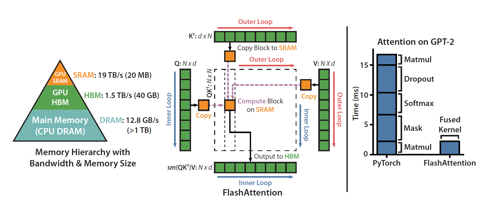

<p align="center">
    <a href="logo">
        
    </a>
</p>

<p align="center">
    <b>
        <font size="5">
            Triton Flash Attention
        </font>
    </b>
</p>


| Python Version | Build Status |
|---------------|-------------|
| 3.8          |  |
| 3.9          |  |
| 3.10         |  |
| 3.11         |  |
| 3.12         |  |
| 3.13         |  |


Coding Flash Attention from scratch using triton and pytorch.

The forward and the backward pass compute exact softmax attention without ever building the
(seq x seq) score matrix, so the extra memory grows linearly with the sequence length. Everything
here was checked against a plain PyTorch implementation on a CPU, in the Triton interpreter and on
a Tesla T4.

## Usage

Tensors have the shape `(batch, heads, seq, head_dim)`, with `head_dim` in 16, 32, 64 or 128 and
one dtype among float16, bfloat16 and float32. The imports are relative to `src`, so run with
`PYTHONPATH=src`.

```python
import torch
from ops.attention import flash_attention

q, k, v = (
    torch.randn(2, 8, 1024, 64, device="cuda", dtype=torch.float16, requires_grad=True)
    for _ in range(3)
)
out = flash_attention(q, k, v, causal=True)
out.float().sum().backward()
```

`flash_attention(q, k, v, causal=False, sm_scale=None, block_m=None, block_n=None, num_warps=None)`
uses `head_dim ** -0.5` as the scale by default. The block sizes default to the ones that
`default_config` picks for the dtype, the head dimension and the card (see the T4 results below).

## What is in the repo

| Path | Content |
|:--|:--|
| `src/kernels/attention.py` | the three Triton kernels: forward, dk and dv, dq |
| `src/ops/attention.py` | `flash_attention`, a `torch.autograd.Function` that checks the inputs, picks the block sizes and launches the kernels |
| `src/ops/reference.py` | the textbook formula and the same block algorithm in plain PyTorch, which runs on a CPU |
| `tests/` | tests of the reference and of the kernels, plus the older checks of the environment and of the vector addition |
| `benchmarks/bench.py` | speed and memory against `scaled_dot_product_attention` and the textbook formula |
| `results/` | the measurements of a Tesla T4: two benchmark tables with their json files and a block size sweep |
| `src/kernels/add.py`, `src/ops/add.py`, `main.py` | the vector addition the repo started with |

## How it works

* **Forward.** One program per block of `BLOCK_M` query rows. It sweeps over the key and value
  blocks and keeps a running maximum, a running sum and a rescaled accumulator (online softmax).
  Scores are kept in base 2 (`exp2` and `log2`, with `log2(e)` folded into the scale), and the
  base-2 log-sum-exp of every row is saved for the backward pass.
* **Backward.** `delta = sum(dO * O)` is computed per row in PyTorch. Then one kernel runs one
  program per block of keys and sweeps over the query blocks to build dk and dv, and a second one
  runs one program per block of queries to build dq. No program adds into the output of another
  one, so there are no atomics and the result does not depend on scheduling: the test suite checks
  that two runs give the same bits.
* **Causal mask.** The loops stop at the diagonal block. The element mask is applied to every
  block but only changes the blocks that cross the diagonal. Sequence lengths that are not a
  multiple of the block size are masked too.
* **Reference.** `naive_attention` is the textbook definition. `tiled_forward` and
  `tiled_backward` run the block algorithm of the kernels one program at a time in PyTorch, with
  the same masks and the same base-2 scores, so the indexing and the maths can be checked on a CPU
  before a GPU is involved.

## Tests

```bash
PYTHONPATH=src pytest tests
```

* `tests/test_reference.py` (86 tests) checks the block algorithm against the textbook formula and
  against autograd. It needs neither a GPU nor Triton.
* `tests/test_attention.py` compares the kernels with the reference, forward and backward, causal
  and not, in float16 and float32 (and bfloat16 on a card that has it): six shapes, several with a
  sequence length that is not a multiple of the block, head dimensions from 16 to 128, unequal
  block sizes, a custom scale, a transposed layout, no dependence on future keys, the same bits
  from two backward passes, the default block sizes for every head dimension and rejected inputs.
  Tolerances are 2e-2 in float16 and 5e-3 in float32. It runs on a GPU, or on a CPU with
  `TRITON_INTERPRET=1`.

What was run (2026-11-14):

| Where | Command | Result |
|:--|:--|:--|
| Tesla T4 (Colab), torch 2.14.1+cu130, triton 3.8.0 | `PYTHONPATH=src pytest tests` | 156 passed |
| Python 3.12, torch 2.6.0 (CPU), triton 3.2.0, numpy 2.2.3 | `TRITON_INTERPRET=1 PYTHONPATH=src pytest tests/test_attention.py` | 23 passed |
| same environment | `PYTHONPATH=src pytest tests/test_reference.py` | 86 passed |

The last two are the jobs of the `Tests` workflow. With numpy 2.5.4 the interpreter of triton 3.2.0
fails on `int()` of a one-element array, which is why numpy is pinned there.

## Results on a Tesla T4

Batch 2, 8 heads, `head_dim` 64, float16, not causal; medians of `triton.testing.do_bench`; the
extra peak memory is the one of a forward plus backward step. Colab T4, torch 2.14.1+cu130,
triton 3.8.0, 2026-11-14, with `PYTHONPATH=src python benchmarks/bench.py --out results`.

| seq | implementation | forward ms | forward + backward ms | extra peak MB |
|--:|:--|--:|--:|--:|
| 2048 | this repo | 12.9 | 63.1 | 28 |
| 2048 | `scaled_dot_product_attention` | 1.3 | 6.2 | 28 |
| 2048 | textbook formula | 9.9 | 28.2 | 1048 |
| 4096 | this repo | 51.3 | 254.6 | 56 |
| 4096 | `scaled_dot_product_attention` | 5.7 | 23.9 | 57 |
| 4096 | textbook formula | 40.9 | 115.2 | 4144 |
| 8192 | this repo | 207.6 | 1023.7 | 112 |
| 8192 | `scaled_dot_product_attention` | 22.8 | 98.7 | 113 |
| 8192 | textbook formula | out of memory | out of memory | out of memory |

The memory is what the kernels are for: it doubles when the sequence length doubles, where the
textbook formula quadruples and runs out of the 15 GB of the card at 8192. The largest difference
with `scaled_dot_product_attention` is 4.9e-4 in float16 and below 5e-6 in float32. The full tables
(causal and not, float16 and float32) are in `results/`.

**The speed is not good on this card.** On a T4 the forward pass runs at about 1.3 TFLOP/s in
float16, roughly 10 times slower than PyTorch's own kernel, and 2 times slower in float32. The
reason is the hardware, not the algorithm: the PTX that Triton 3.8.0 generates for the forward
kernel on `sm_75` (64 x 64 blocks, float16 or float32) holds 4104 scalar `fma.rn.f32`
instructions and no `mma.sync` or `wmma` instruction, so `tl.dot` does not use the tensor cores of
a Turing card. As far as I know Triton uses them from Ampere on, but I had no such card, so every
number above is a T4 one. The kernels are correct there, which is what the tests establish.

Block sizes matter on this card. With 64 x 64 blocks and 4 warps at `head_dim` 64 the kernels
spill registers (Triton reports 404 spills for the non-causal forward kernel and 1454 for the
causal one) and the float16 forward pass at sequence length 2048 took 33.4 ms, or 98.3 ms when
causal. With 32 x 32 blocks it takes 12.7 ms and 6.8 ms. `default_config` therefore caps the
blocks at 32 rows before Ampere, and it keeps every tile within 8 KB of shared memory: the dk and
dv kernel in float32 with 64 x 64 blocks at `head_dim` 64 needs 80 KB, and the T4 has 64 KB. The
sweep behind this is in `results/block_sweep_tesla-t4.md`, and
`PYTHONPATH=src python benchmarks/bench.py --tune` repeats it on another card.

## Limits

* `q`, `k` and `v` must have the same shape: no grouped-query attention and no cross-attention
  with different lengths.
* The only mask is the causal one. There is no dropout, no sliding window and no bias.
* `head_dim` must be 16, 32, 64 or 128.
* The speed and the default block sizes were measured on a T4 only. The bfloat16 path was never run
  on a card that supports it.

## Setup environment
* Clone the repository and Go to `triton-flash-attn` directory.
```bash
git clone https://github.com/eljandoubi/triton-flash-attn.git && cd triton-flash-attn
```

* Build environment.
```bash
make build
```

## Clean environment
```bash
make clean
```
